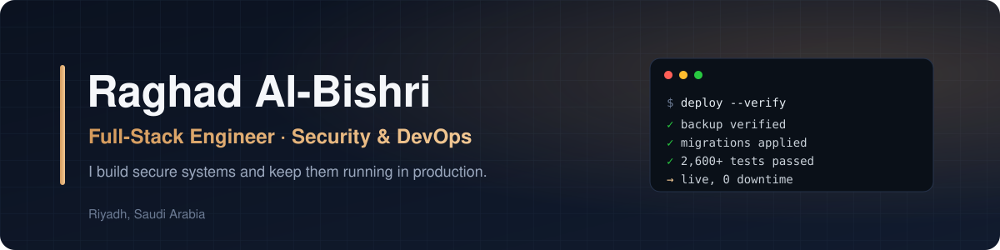

  

  
  
  

---

### About me

I'm the **technical owner** of my company's **production task-management platform** — I lead its architecture, permissions, security and releases — and I operate the **production server** that hosts the company's internal systems.

I care about two things: **access control that holds up under real attacks**, and **releases that never surprise anyone**.

 

### Impact in production

<table>
  <tr>
    <td align="center" width="25%"><h3>7-phase</h3>privilege-escalation hardening across every module</td>
    <td align="center" width="25%"><h3>2,600+</h3>automated backend tests as release gates</td>
    <td align="center" width="25%"><h3>1,400+</h3>end-to-end browser checks across all roles</td>
    <td align="center" width="25%"><h3>&lt; 1 min</h3>rollback by image re-tagging</td>
  </tr>
</table>

- 🛡️ **Security** — fine-grained RBAC for 13 role variants with row-level ownership; fixed IDOR vulnerabilities, stored XSS and other external penetration-test findings.
- 🐳 **Operations** — Docker Compose stacks behind nginx with wildcard TLS and Cloudflare; migrated 3 production databases into containers with verified dump/restore.
- 🚀 **Releases** — build first, tag a rollback point, run migrations in a one-off container, swap one service, then check logs and 5xx errors.
- 🔐 **Identity** — rebuilt password reset for the shared login service (single-use links, SHA-256 token digests, per-email throttling).

 

### Featured work

<table>
  <tr>
    <td width="50%" valign="top">
      <h4>🛡️ <a href="https://github.com/raghadalb-tech/fastapi-armor">fastapi-armor</a></h4>
      
Production-ready logging, JSON error handling and Sentry monitoring for any FastAPI app — in one line. Published on <a href="https://pypi.org/project/fastapi-armor-lib/">PyPI</a>.

      <code>Python</code> <code>FastAPI</code> <code>Sentry</code> <code>pytest</code>
    </td>
    <td width="50%" valign="top">
      <h4>🧠 <a href="https://github.com/raghadalb-tech/mindtrack-portfolio">MindTrack</a></h4>
      
AI task organizer for university students with ADHD. Graduation project, built end to end as sole developer.

      <code>Flutter</code> <code>FastAPI</code> <code>Google Gemini</code> <code>JWT</code>
    </td>
  </tr>
</table>

 

### Tech stack

  

  

| Area | Tools |
|:---|:---|
| **Backend** | FastAPI · SQLAlchemy · Alembic · Pydantic · Ruby on Rails · WebSockets |
| **Frontend & mobile** | React · Vite · Flutter · Tailwind CSS · Arabic RTL · WCAG 2.1 AA |
| **DevOps** | Docker Compose · nginx · Linux · Cloudflare · Fail2ban · backup & recovery |
| **Security** | RBAC · OWASP Top 10 · SSO · rate limiting · secrets management · audit logging |
| **Testing** | pytest · Playwright · Vitest · RSpec · Sentry |

 

### Education

- **B.Sc. Information Technology** — Princess Nourah bint Abdulrahman University, 2026
- Microsoft Certified: Azure AI Fundamentals
- Cloud Solutions Engineering — Tuwaiq Academy
---

  Most of my production work lives in private company repositories — the contribution graph includes those private contributions.

